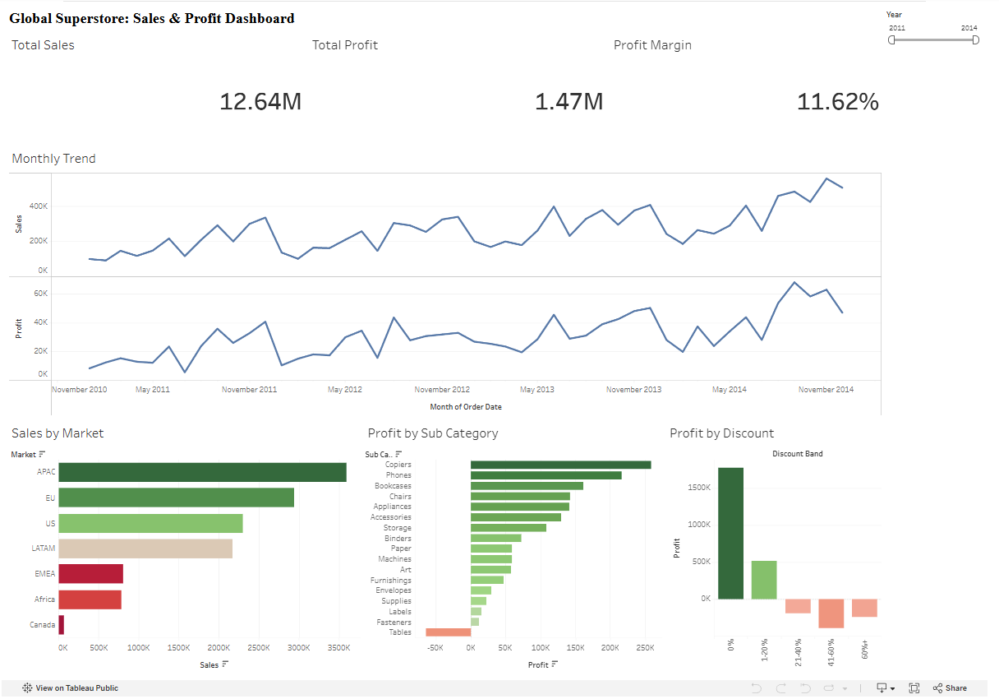

# Global Superstore: Sales & Profit Dashboard (Tableau)

An interactive Tableau dashboard that answers one business question: **where does the company make money, and where does it lose it?**

**[View the live dashboard on Tableau Public](https://public.tableau.com/app/profile/shams.asadova/viz/GlobalSuperstoreDashboard_17919049447050/Dashboard1)**



## Business questions

1. How have sales and profit changed from 2011 to 2014?
2. Which markets generate the most sales and profit?
3. Which product sub-categories lose money?
4. How do discounts affect profit?

## Key findings

| Metric | Value |
|---|---|
| Total sales | $12.64M |
| Total profit | $1.47M |
| Profit margin | 11.6% |
| Order lines analyzed | 51,290 |

- **Steady growth.** Sales grew from $2.26M in 2011 to $4.30M in 2014, and profit from $249K to $504K. The margin stayed around 11-12%.
- **APAC leads.** APAC is the largest market ($3.59M sales, $438K profit). EMEA has $806K in sales but only $44K in profit (about a 5% margin), well below the other large markets.
- **Tables lose money.** Tables is the only sub-category with negative profit (-$64K) even though it generated $757K in sales.
- **Discounts above 20% destroy profit.** Orders with no discount earned $1.77M in profit and orders with a 1-20% discount earned $513K. Every band above 20% is negative: 21-40% (-$187K), 41-60% (-$388K), 60%+ (-$239K), about -$815K combined.

## Recommendations

1. Cap discounts at 20% unless approved case by case.
2. Review pricing and discounting for the Tables sub-category.
3. Investigate why EMEA margins are so much lower than other markets (shipping cost, discounting, product mix).

## Dashboard features

- KPI cards: total sales, total profit, profit margin
- Monthly sales and profit trend (2011-2014)
- Sales by market, colored by profit
- Profit by sub-category
- Profit by discount band
- Year filter that updates every chart, and click-to-filter on the market and sub-category charts

## Data

- Source: Global Superstore dataset from Kaggle (51,290 rows, 21 columns, 2011-2014).
- `SuperStoreOrders.csv`: original file.
- `SuperStoreOrders_clean.csv`: cleaned file used in the dashboard.

### Data cleaning

- `order_date` and `ship_date` mixed two formats (`1/1/2011` and `13-01-2011`). Both are day/month/year. I checked this by confirming that ship date minus order date is between 0 and 7 days for every row, and converted all dates to ISO format (`YYYY-MM-DD`). Without this step, Tableau misreads about 60% of the dates.
- `sales` was stored as text with thousands separators (for example `1,648`). I converted it to a number.
- Totals match between the raw and cleaned files (sales $12,642,905, profit $1,469,035).

### Calculated fields

- `Profit Margin = SUM([Profit]) / SUM([Sales])`
- `Discount Band`: groups `Discount` into 0%, 1-20%, 21-40%, 41-60%, 60%+

## Tools

Tableau Public, Python (pandas) for data cleaning.

## Repository structure

```
.
├── README.md
├── dashboard.png
├── SuperStoreOrders.csv
└── SuperStoreOrders_clean.csv
```

## Author

Shams Asadova
